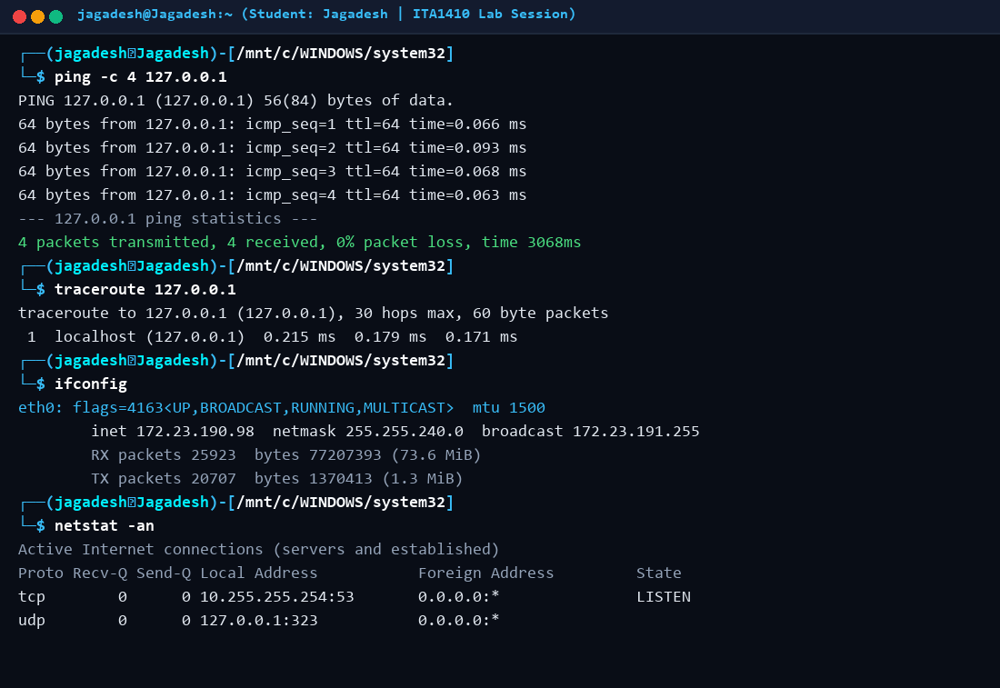

# EXPERIMENT – 17

**Student:** E. Jagadesh Sai (Jagadesh)

**Question:** Execute Windows OS commands such as traceroute, ping, ifconfig and netstat.

### Aim
To execute basic networking commands and understand network connectivity in Windows.

### Commands
```bash
1. Ping:
ping google.com

2. Traceroute:
tracert google.com

3. IP Configuration:
ipconfig

4. Netstat:
netstat -an
```

### Terminal Output Screenshot (User: Jagadesh)


### Use
These commands are used to check network connectivity, trace network routes, display IP configuration and view network connections.

### Result
Thus, Windows networking commands were successfully executed and their outputs were displayed.
