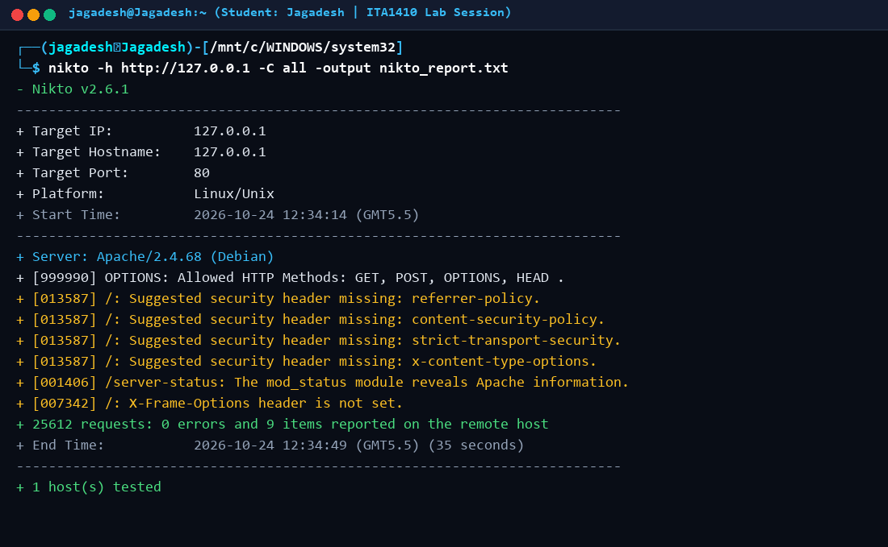

# EXPERIMENT – 18

**Student:** E. Jagadesh Sai (Jagadesh)

**Question:** Perform vulnerability analysis using CGI scanning with Nikto.

### Aim
To identify possible web server vulnerabilities using the Nikto scanning tool.

### Commands
```bash
nikto -h http://127.0.0.1
```

### Terminal Output Screenshot (User: Jagadesh)


### Use
The Nikto tool is used to scan web servers and identify possible security issues.

### Result
Thus, the Nikto tool was successfully executed and possible web server security issues were identified.
