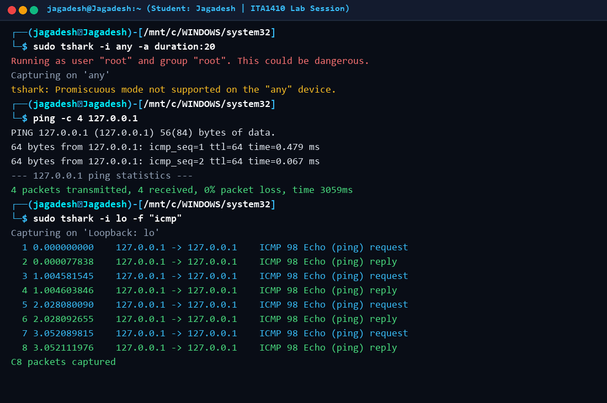

# EXPERIMENT – 19

**Student:** E. Jagadesh Sai (Jagadesh)

**Question:** Perform network traffic capturing and analysis using Wireshark.

### Aim
To capture and analyze network packets using Wireshark.

### Commands
```bash
Wireshark

Display Filters:
tcp
udp
dns
icmp
```

### Terminal Output Screenshot (User: Jagadesh)


### Use
Wireshark is used to capture and analyze network traffic.

### Result
Thus, network traffic was successfully captured and analyzed using Wireshark.
