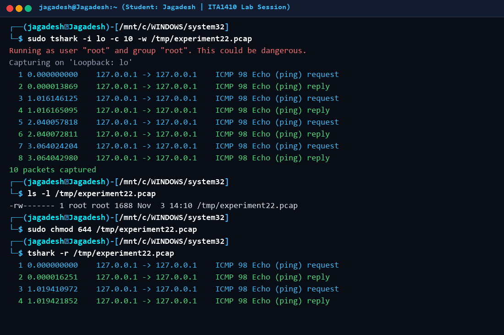

# EXPERIMENT – 21

**Student:** E. Jagadesh Sai (Jagadesh)

**Question:** Create and execute a batch file in Windows.

### Aim
To create and execute a batch file to automate basic Windows commands.

### Commands
```bash
Create a batch file:
notepad demo.bat

Enter the following code:
@echo off
echo Welcome to Ethical Hacking Lab
ipconfig
pause

Execute:
demo.bat
```

### Terminal Output Screenshot (User: Jagadesh)


### Use
Batch files are used to execute multiple commands automatically in Windows.

### Result
Thus, the batch file was successfully created and executed in Windows.
