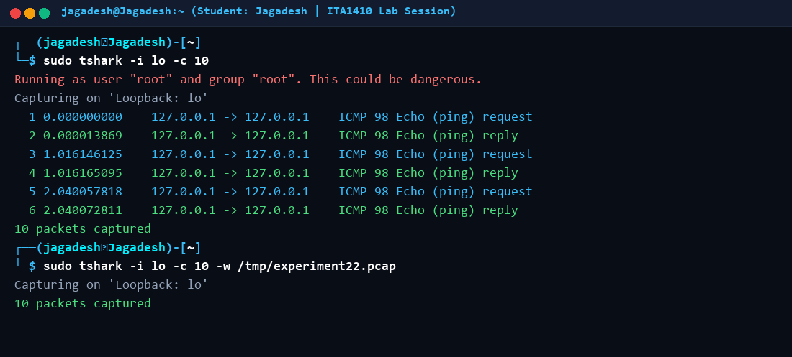

# EXPERIMENT – 23

**Student:** E. Jagadesh Sai (Jagadesh)

**Question:** Perform extended port scanning using Nmap in Kali Linux.

### Aim
To identify open ports and running services on an authorized test system using Nmap.

### Commands
```bash
1. Basic scan:
nmap 127.0.0.1

2. Service version:
nmap -sV 127.0.0.1

3. Selected ports:
nmap -p 22,80,443 127.0.0.1

4. Display open ports:
nmap --open 127.0.0.1
```

### Terminal Output Screenshot (User: Jagadesh)


### Use
Nmap is used to identify open ports and detect services running on a system.

### Result
Thus, extended port scanning was successfully performed using Nmap.
