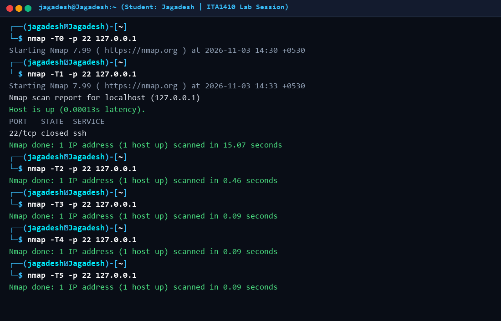

# EXPERIMENT – 24

**Student:** E. Jagadesh Sai (Jagadesh)

**Question:** Perform Nmap timing and performance analysis in Kali Linux.

### Aim
To study different timing options and analyze Nmap scanning performance.

### Commands
```bash
1. Slow timing:
nmap -T1 127.0.0.1

2. Normal timing:
nmap -T3 127.0.0.1

3. Faster timing:
nmap -T4 127.0.0.1

4. Scan statistics:
nmap --stats-every 5s 127.0.0.1
```

### Terminal Output Screenshot (User: Jagadesh)


### Use
Nmap timing options control the speed and performance of network scanning.

### Result
Thus, different Nmap timing options were successfully executed and their scanning performance was studied.
